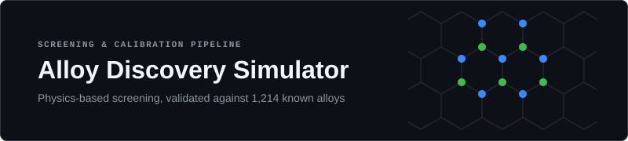
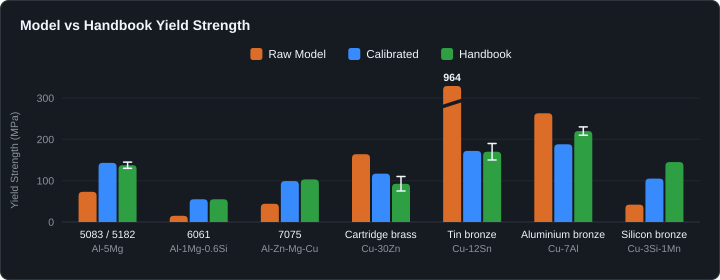
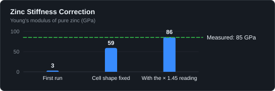

# Alloy discovery simulator

A physics pipeline that looks for new metal alloys on a desktop computer. It samples thousands of candidate
compositions, sifts them with the standard alloy-design rules, simulates the survivors atom by atom with a
machine-learned interatomic potential (MACE), and ranks what is left by strength, stiffness and phase stability.
Before any of its output is believed it is run against 1,214 known alloys and scored.

> [!NOTE]
> **How this was built.** The code in this repository was written by an AI coding agent (Anthropic's Claude) working
> under my direction. Two other AI models (Google's Gemini and xAI's Grok) reviewed the physics, proposed alloy
> families and cross-checked the model's constants and results. I set the goals, chose what to pursue and reviewed
> the results. Nothing here has been melted or measured: every "candidate" is a computational prediction, and
> [`docs/DESIGN.md`](docs/DESIGN.md) says what the physics leaves out.

## What it does


1. **Sample** a few thousand compositions inside a family's rules (an element pool, 2–6 elements, composition bounds).
2. **Screen** them in milliseconds with composition rules: Miedema mixing enthalpy, mixing entropy, atomic-size
   mismatch, Ω, valence-electron concentration.
3. **Shortlist** about a dozen that are far apart from each other.
4. **Simulate** each one with MACE-MPA-0 (PyTorch, ASE, pymatgen):
   - relax ~100-atom random solid-solution cells on the candidate lattices (fcc, bcc, hcp) → which lattice wins,
     formation energy, density;
   - relax the ordered compounds the elements could form instead (B2, L1₂, L1₀, Laves, A15, σ, Heusler and others)
     and solve a small linear programme for the cheapest mixture → does the alloy stay one phase, and what would it
     rather be;
   - strain the cell twelve ways → elastic constants, bulk, shear and Young's modulus, ductility indicators;
   - feed those into solute-strengthening theory (Varvenne–Curtin for fcc, Maresca–Curtin for bcc) → a yield stress
     from 77 K to 1200 K.
5. **Rank** by an objective, with a penalty for alloys that would decompose or whose lattice is mechanically unstable.
6. **Compare** each candidate with a database of known alloys and write `results/<run>/DISCOVERIES.md`.

Candidates are evaluated in parallel worker processes; every result is written to disk as it finishes, so a run that
is stopped picks up where it left off.

## What came out

Full account: [`docs/RESULTS.md`](docs/RESULTS.md). Tables: [`results/`](results/README.md).



*Yield strength of seven classic alloys in their soft state (annealed, or as cast): the raw model, the same number
after calibration, and the handbook value (bar: middle of the published range; line: the range). Tin bronze's raw
value runs off the scale. The calibration factors were measured on known alloys of the same systems, so this is a
consistency check, not an independent test. The numbers are in [`docs/RESULTS.md`](docs/RESULTS.md).*

- **Validation against 1,214 known alloys:** the right crystal lattice for 99 % of the alloys that have a single
  right answer, a median density error of 1.0 %, stiffness within about 10 % for aluminium, magnesium, copper and
  nickel alloys.
- **Where it is wrong, it is wrong in ways that could be measured:** iron and chromium on an fcc lattice come out
  soft (the model has no magnetism), the stiffness of niobium and tantalum fails, zinc reads a third low, and the
  yield-strength model is off by up to a factor of five between alloy systems while being consistent inside each
  one. The validation turned that last one into a calibration table, now a column in every new results table.

  

  *Pure zinc's stiffness: the first validation run, after hexagonal cells were given their own shape, and read with
  the × 1.45 factor. That factor was fitted to the zinc alloys, so the last bar agrees by construction.*
- **Two candidates** hold up under every reading they were given — Ti45Mo35V11Zr9 and Ni40Fe29Cr17V14 — with caveats
  that are spelled out. No literature search for those exact compositions has been done.
- **Negative results, kept:** the well-explored families (the Cantor space, aluminium, copper, zinc, magnesium) gave
  nothing new and re-found the classics at their handbook values; a "high-entropy brass" idea fails on thermodynamics; a
  classical potential tried for zinc turned out wrong for zinc alloys.

## Run it

Linux, Python 3.11 or 3.12. A CPU is enough — every result here was computed on one. Each worker process needs about
2 GB of memory at the default cell size.

```bash
bash setup_sim.sh                 # builds ./.venv with uv: Python 3.12, CPU PyTorch, MACE, ASE, pymatgen, matminer
# or, in an environment of your own:
pip install torch --index-url https://download.pytorch.org/whl/cpu
pip install -r requirements.txt
```

The first run downloads the MACE-MPA-0 model (once, into `~/.cache/mace`).

```bash
# a small try-out: two aluminium candidates in 32-atom cells — about a minute and a half on a 2-core machine
.venv/bin/python run_search.py --family backyard_al --objective strong_ductile_cal --sample 300 --keep 2 --atoms 32 --no-hull --run-name try-al
# the same through the whole chain (drop --no-hull): about 15 minutes there, nearly all of it spent once on the
# compounds four elements can form, which are cached afterwards

# does the engine reproduce known physics? → SMOKE_REPORT.md
.venv/bin/python run_smoke.py

# a real discovery run → results/<run>/DISCOVERIES.md (+ one JSON per candidate)
.venv/bin/python run_search.py --family medium_entropy_fcc --objective strong_ductile --sample 3000 --keep 12 --include CoCrNi

# stacking-fault energies of a run's top fcc candidates → results/<run>/SFE.md
.venv/bin/python run_sfe.py --from-run <run> --top 6
```

On a 16-thread desktop CPU a candidate takes 20–40 minutes at the default cell size (108 atoms), and a 12-candidate
run with four workers about three hours. The compounds each pair of elements can form are computed once and cached
in `cache/`, so later runs in the same family are faster.

Families: `3d_hea`, `refractory`, `medium_entropy_fcc`, `ti_light_bcc`, `cu_alloys`, and five "backyard" families of
metals a hobby foundry can pour (`backyard_al`, `backyard_cu`, `backyard_zn`, `backyard_hea`, `backyard_mg`).
Objectives: `specific_strength`, `high_temp`, `strong_ductile`, `strong_ductile_cal` (calibrated yield),
`stability`, `stiff_stable`. `--include` pushes known alloys through first; `--workers N` sets how many candidates
run at once; `--seed` and `--avoid-run` make a second pass that stays clear of the first.

### The validation, and the "new?" column

Both need a database of known alloys, and the one used for the results here (1,482 alloys) is not part of this
repository. Without one, discovery runs work and their "new?" column reads `n/a`. The format is described in
[`docs/DATABASE.md`](docs/DATABASE.md), and ten well-known alloys are included as an example:

```bash
ALLOYS_DB=data/alloys.example.json .venv/bin/python run_validate.py --list                 # what would run, and why
ALLOYS_DB=data/alloys.example.json .venv/bin/python run_validate.py --tier 1 --atoms 32   # lattice and density; minutes,
                                                 # most of them one-time reference cells for the fifteen elements involved
```

## What is here

```
alloysim/        the package: screen.py (composition rules), atomistic.py (cells, relaxations, compounds, elastic
                 constants), strength.py (yield), calibrate.py (the validation's reading of the numbers), search.py
                 (the funnel), validate.py (the scorecard), sfe.py (stacking faults), compo.py, elements.py
run_*.py         the command-line entry points
diag_cantor.py   one cell on GPU and CPU — the check that showed an AMD GPU's forces to be wrong, hence the CPU default
meam_check.py    a classical MEAM potential against experiment through LAMMPS (the zinc cross-check)
docs/            DESIGN.md (the physics and its limits), RESULTS.md (what came out), DATABASE.md
results/         the tables of the discovery and confirmation runs, the validation scorecard, the smoke-test report
data/            alloys.example.json
assets/          the banner and figures of this page, and make_figures.py, which draws them
```

## What is not here

> [!NOTE]
> - The reference database of 1,482 known alloys, and the per-alloy validation results derived from it.
> - The per-candidate JSON files of the runs, the caches and the logs.
> - The job queue and the desktop control panel that scheduled these runs on the machine they were computed on.
> - Any interatomic-potential files. MACE-MPA-0 is downloaded by the `mace-torch` package; the MEAM set used in
>   `meam_check.py` comes from the NIST Interatomic Potentials Repository.

## Limits

> [!WARNING]
> The cells are random substitutional solid solutions at 0 K. Not modelled: interstitial elements (so not steels as
> steels), precipitation hardening, grain size, magnetism, short-range order, melting, corrosion, fatigue. The phase
> prediction knows a fixed list of compound types. The yield strength is solute strengthening alone. Each of these is
> quantified against known alloys in `docs/RESULTS.md`; none of it replaces a phase diagram, a handbook or a furnace.
